<div align="center">


# 도담 Frontend


[Spring Backend](https://github.com/ieum-connect/Dodam_backend) · [AI Backend](https://github.com/ieum-connect/Dodam_AI_backend)

</div>

---

## 1. 🧭 전체 시스템 구조

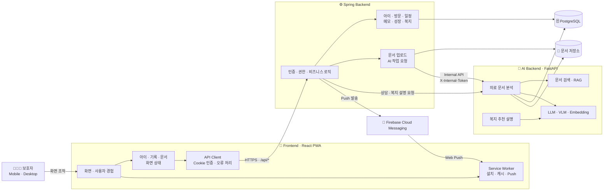

<details>
<summary><b>🔎 서비스별 책임 자세히 보기</b></summary>

| 영역 | 주요 책임 |
|---|---|
| 🎨 Frontend | 화면 렌더링, 사용자 입력, 아이 선택, API 요청, 처리 상태 표시, PWA와 Push |
| ⚙️ Spring Backend | 로그인, 접근 권한, 데이터 검증, 핵심 도메인 관리, AI 요청 중계와 결과 조회 |
| 🤖 AI Backend | 의료 문서 분석, 문서 임베딩, 근거 검색, AI 상담, 복지 추천 설명 |
| 🗄️ PostgreSQL | 사용자·아이·방문·문서·일정·AI 결과 저장 |
| 📁 문서 저장소 | 원본 건강 문서와 처리 파일 저장 |
| 🔔 Firebase | 브라우저와 설치형 PWA에 Web Push 전달 |

</details>

---

## 2. 🎨 프론트엔드의 위치와 역할

> 프론트엔드는 **AI 서버를 직접 호출하지 않습니다.**
> 모든 요청은 Spring Backend에서 인증과 아이 접근 권한을 확인한 뒤 필요한 작업만 AI Backend로 전달합니다.

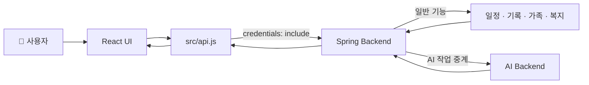

<details>
<summary><b>🧩 프론트엔드가 담당하는 일</b></summary>

- 📱 모바일 우선 화면과 데스크톱 반응형 UI
- 👶 로그인 상태, 현재 사용자와 선택한 아이 관리
- 🏥 병원 방문·문서·메모·성장·예방접종 화면 연결
- 🤖 AI 작업의 대기·진행·완료·실패 상태 표시
- 💊 복약·일정 등록, 수정, 취소와 완료 처리
- 🔔 알림 클릭 후 관련 아이와 날짜로 이동
- 📲 PWA 설치, 캐시와 오프라인 대체 화면
- 🔐 Firebase Token 등록·해제와 Push 설정
- 💬 API 오류를 사용자 친화적인 메시지로 변환

AI API Key, 데이터베이스 계정, JWT Secret과 내부 통신 Token은 브라우저에 저장하지 않습니다.

</details>

---

## 3. 🔄 주요 서비스 흐름

<details open>
<summary><b>📄 건강 문서 업로드 → AI 분석</b></summary>

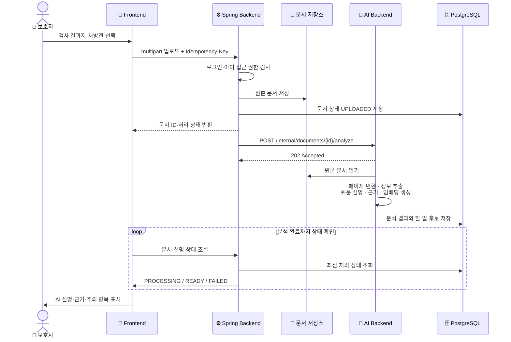

> 일정이나 복약 후보는 보호자가 내용을 확인하고 승인해야 실제 일정으로 생성됩니다.

</details>

<details>
<summary><b>💬 문서 기반 AI 건강 상담</b></summary>

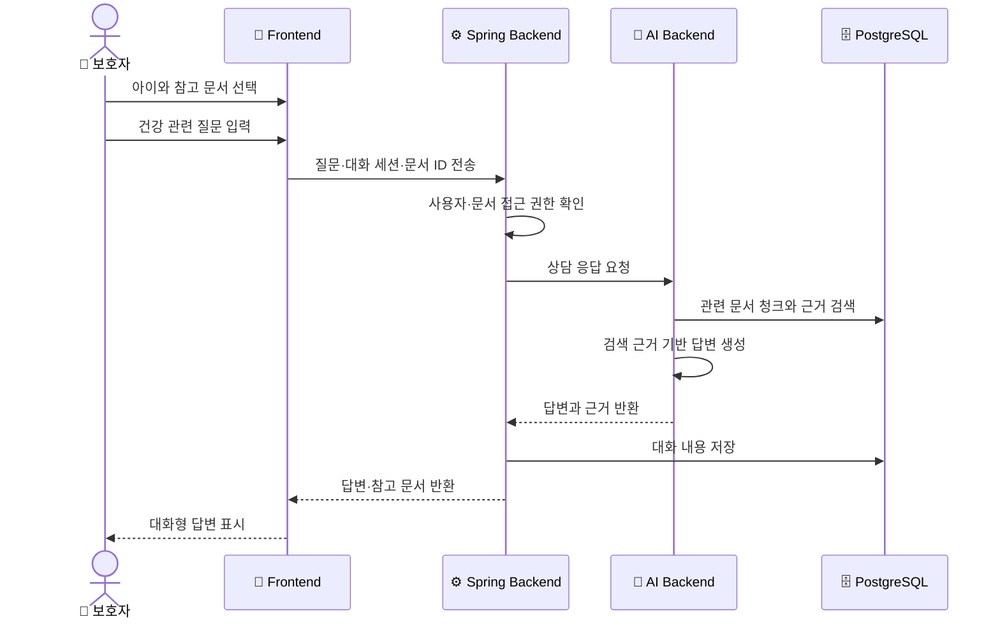

</details>

<details>
<summary><b>📝 메모·일정 저장과 조회</b></summary>

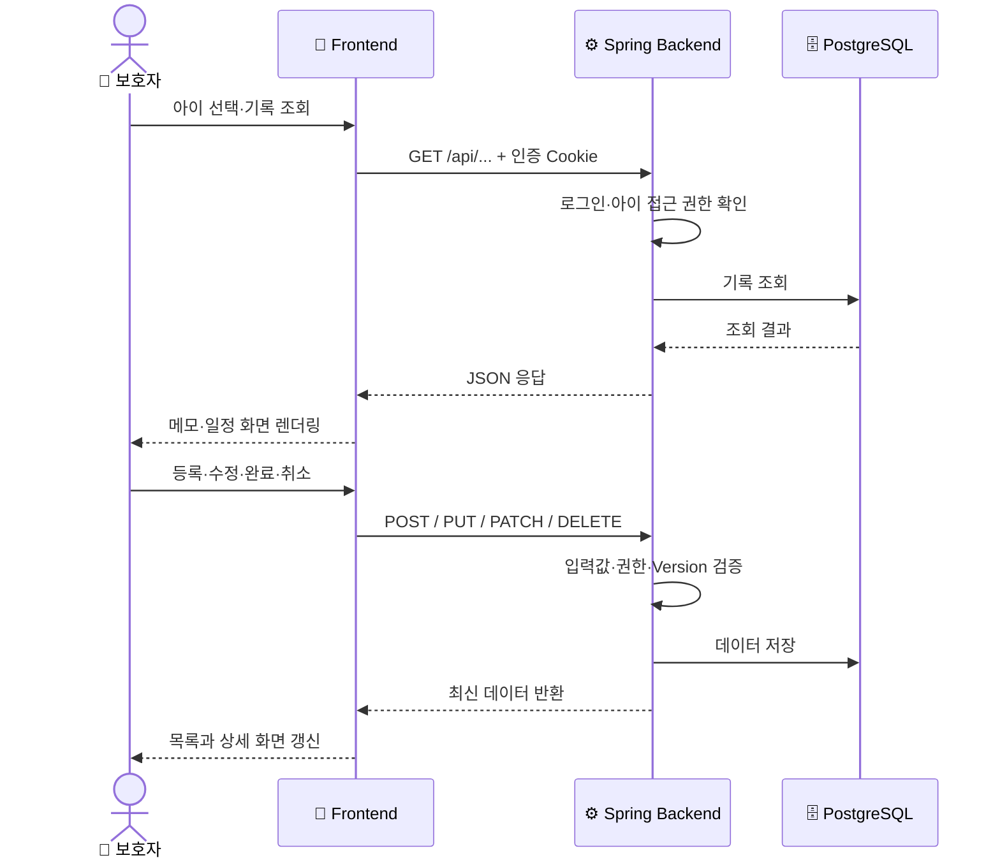

</details>

---

## 4. 🛠️ 기술 스택

<details open>
<summary><b>🎨 Frontend</b></summary>

| 분류 | 기술 | 사용 목적 |
|---|---|---|
| UI | React | Component 기반 화면 구현 |
| Build | Vite | 개발 서버와 Production Bundle 생성 |
| Language | JavaScript · JSX | Frontend Application 구현 |
| Styling | CSS | Mobile First 반응형 UI |
| Icons | Lucide React | 서비스 아이콘 |
| API | Fetch API | Spring Backend HTTP 통신 |
| Push | Firebase Cloud Messaging | Browser·PWA Web Push |
| PWA | Service Worker · Web App Manifest | 설치, 캐시와 Offline 대응 |
| Test | Node.js Test Runner | 성장 그래프·Timeline 회귀 테스트 |

</details>

<details>
<summary><b>🔗 연동 시스템</b></summary>

| 분류 | 기술 |
|---|---|
| Business Backend | Spring Boot |
| AI Backend | FastAPI |
| Database | PostgreSQL |
| Authentication | Kakao OAuth2 · 인증 Cookie |
| AI | LLM · VLM · Embedding · RAG |
| Push Provider | Firebase Cloud Messaging |

</details>

---

## 5. 🤝 개발 컨벤션

Frontend와 Backend는 같은 Git 흐름을 사용합니다. 변경 이력을 추적할 수 있고 리뷰하기 쉬운 크기로 유지하는 것이 핵심 원칙입니다.

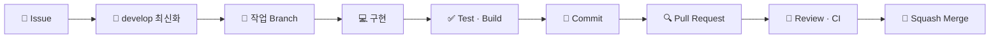

<details open>
<summary><b>🌿 1. Branch Convention</b></summary>

[브랜치 컨벤션 전체 문서](https://github.com/ieum-connect/Dodam_backend/blob/develop/docs/convention/BRANCH_CONVENTION.md)

```text
main                         # 배포 가능한 안정 Branch
 └─ develop                  # 기능 통합·검증 Branch
     ├─ feat/12-short-name   # 새 기능
     ├─ fix/18-short-name    # Bug 수정
     ├─ refactor/23-name     # 구조 개선
     ├─ docs/25-name         # 문서
     ├─ test/29-name         # Test
     └─ chore/31-name        # 설정·의존성·정리

hotfix/35-short-name         # main 기준 긴급 운영 수정
```

| Type | 사용 시점 | 예시 |
|---|---|---|
| `feat` | 사용자 기능 추가 | `feat/12-child-care-memo-time` |
| `fix` | 오류와 회귀 수정 | `fix/70-chat-mobile-layout` |
| `refactor` | 동작 변화 없는 구조 개선 | `refactor/23-api-client` |
| `docs` | README·문서 수정 | `docs/25-readme-preview` |
| `test` | 테스트 추가·수정 | `test/29-timeline-pagination` |
| `chore` | 도구·설정·의존성 정리 | `chore/31-vite-config` |

- 형식은 `<type>/<issue-number>-<short-kebab-case-description>`입니다.
- 새 작업은 최신 `develop`에서 분기하고 한 Branch에는 하나의 Issue만 담습니다.
- `main`과 `develop`에는 직접 Push하지 않습니다.
- 긴급 수정은 `main`에서 `hotfix/*`로 분기하고 병합 후 `develop`에도 반영합니다.
</details>

<details open>
<summary><b>📝 2. Commit Convention</b></summary>

[커밋 컨벤션 전체 문서](https://github.com/ieum-connect/Dodam_backend/blob/develop/docs/convention/COMMIT_CONVENTION.md)

```text
<type>(<scope>): <english subject>

<선택: 변경 이유와 구현 방식>
<선택: Refs: #issue-number>
```

```text
feat(memo): support recorded time selection
fix(chat): keep mobile header sticky
docs(readme): add product screen previews
test(timeline): cover repeated cursor response
```

- Type·Scope·Subject는 소문자 영어로 쓰고 제목 끝에 마침표를 붙이지 않습니다.
- Subject는 명령형 현재 시제로 간결하게 작성합니다.
- 하나의 Commit에는 하나의 논리적 변경만 담고 포맷 수정과 기능 변경을 섞지 않습니다.
- 권장 Scope: `auth`, `child`, `memo`, `schedule`, `document`, `chat`, `growth`, `welfare`, `push`, `pwa`, `ui`, `api`, `readme`.
</details>

<details open>
<summary><b>🔀 3. Pull Request Convention</b></summary>

[PR 컨벤션 전체 문서](https://github.com/ieum-connect/Dodam_backend/blob/develop/docs/convention/PR_CONVENTION.md)

```text
PR 제목: <type>(<scope>): <한국어 변경 내용>
예시: fix(chat): 모바일 채팅 헤더 고정 복원
```

| 필수 항목 | 작성 내용 |
|---|---|
| 무엇을 구현했나요? | 사용자 또는 시스템 관점의 변경 사항 |
| 참고할 사항 | API·환경 변수·연동 저장소·UI 영향 |
| 테스트 | 실행 명령, 수동 확인 결과, 미확인 항목과 사유 |
| 화면 | UI 변경 전·후 이미지 또는 영상 |
| 연결된 이슈 | `Closes #이슈번호` |

- 대상 Branch는 원칙적으로 `develop`이며 Draft PR로 조기 공유할 수 있습니다.
- UI 변경은 모바일·데스크톱 캡처와 재현 절차를 첨부합니다.
- CI 통과와 1명 이상 Approve 후 Squash and merge하고 작업 Branch를 삭제합니다.
</details>

<details>
<summary><b>🎨 4. Frontend Code Style</b></summary>

| 영역 | 규칙 |
|---|---|
| Component | 화면 책임 단위로 분리하고 이름은 `PascalCase`를 사용합니다. |
| 함수·변수 | `camelCase`를 사용하며 Boolean은 `is`, `has`, `can`, `should`로 시작합니다. |
| CSS | Mobile First로 작성하고 기존 Design Token과 Class naming을 재사용합니다. |
| API | 화면에서 URL을 직접 조합하지 않고 공통 API Client를 사용합니다. |
| 상태 | 서버·화면·입력 상태를 구분하고 파생 값은 중복 저장하지 않습니다. |
| 접근성 | Icon Button에 접근 가능한 이름을 제공하고 Keyboard·Focus 흐름을 확인합니다. |
| 보안 | Secret과 내부 Token을 `VITE_` 환경 변수나 Browser Storage에 넣지 않습니다. |

- Loading·Empty·Error·Success 상태를 모두 고려합니다.
- 모바일 키보드, Safe Area, 긴 텍스트, 작은 화면과 PWA 환경을 검증합니다.
- 주석은 코드의 동작보다 제약과 결정 이유를 설명할 때 작성합니다.
</details>

<details>
<summary><b>✅ 5. 리뷰 전 체크리스트</b></summary>

- [ ] 최신 `develop`을 반영했고 불필요한 변경 파일이 없습니다.
- [ ] `npm run build`와 관련 테스트가 통과합니다.
- [ ] Browser Console 오류와 경고를 확인했습니다.
- [ ] 모바일·데스크톱 반응형과 Loading·Empty·Error 상태를 확인했습니다.
- [ ] 개인정보·Secret·Test Credential이 Commit에 포함되지 않았습니다.
- [ ] API·환경 변수·PWA Cache 변경을 README와 PR 본문에 기록했습니다.
- [ ] UI 변경 화면과 수동 검증 절차를 첨부했습니다.
</details>

---

## 6. 📲 PWA와 푸시 알림

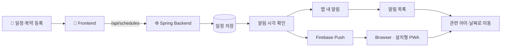

<details>
<summary><b>🔔 Web Push 등록 흐름</b></summary>

1. `/api/push/config`에서 공개 설정을 받습니다.
2. 사용자가 Browser 알림 권한을 허용합니다.
3. Firebase Push Token을 발급받습니다.
4. Token을 Spring Backend에 등록합니다.
5. 알림 발생 시 Firebase를 통해 Push를 전송합니다.
6. 알림을 누르면 도담 알림 화면으로 이동합니다.

로그아웃 또는 계정 전환 시 등록된 기기 Token을 해제합니다.

</details>

<details>
<summary><b>📦 PWA 캐시 정책</b></summary>

- Production Build에서만 Service Worker를 등록합니다.
- 페이지 요청은 **Network First**로 처리합니다.
- `/assets/` Hash 파일은 **Cache First**로 처리합니다.
- API·OAuth·Login·Logout 요청은 Service Worker Cache에서 제외합니다.
- Network와 필수 Cache를 사용할 수 없으면 `offline.html`을 표시합니다.

</details>

<details>
<summary><b>🚀 운영 배포 체크리스트</b></summary>

- Service Worker와 Push API 사용을 위해 HTTPS가 필요합니다.
- iOS는 Safari에서 홈 화면에 추가한 PWA로 Push를 사용합니다.
- `index.html`, `sw.js`, `manifest.webmanifest`는 `Cache-Control: no-cache`를 권장합니다.
- Hash가 포함된 `/assets/*` 파일은 장기 Cache할 수 있습니다.
- `manifest.webmanifest`는 `application/manifest+json` MIME Type으로 제공합니다.
- API와 OAuth 경로는 Frontend와 동일 출처로 제공하는 구성을 권장합니다.

</details>

---

## 7. 🖼️ 화면 미리보기

> 현재 Frontend와 Local Demo Data를 기준으로 직접 캡처한 화면입니다.

화면 설계서: [Claude Artifact에서 화면 설계서 열기](https://claude.ai/artifact/HbHHm56cdtbRuStCtJJt2T#page-dcb81aee8d83)

<details>
<summary><b>📝 육아 메모 화면 보기</b></summary>

<br />

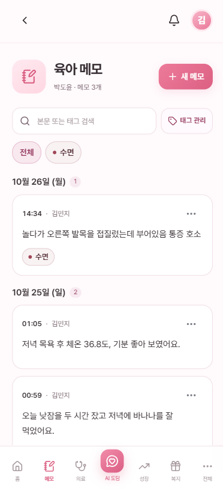

</details>

<details>
<summary><b>📅 일정 화면 보기</b></summary>

<br />

<table>
  <tr>
    <td align="center"><b>새 일정 추가</b><br>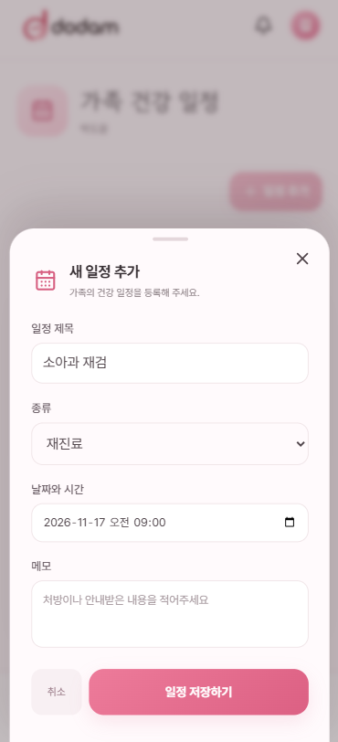</td>
    <td align="center"><b>일정 캘린더</b><br>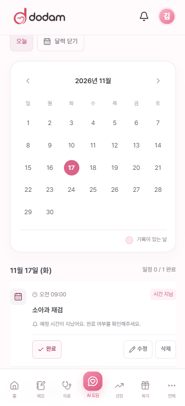</td>
  </tr>
</table>

</details>

<details>
<summary><b>📄 건강 문서 업로드 화면 보기</b></summary>

<br />

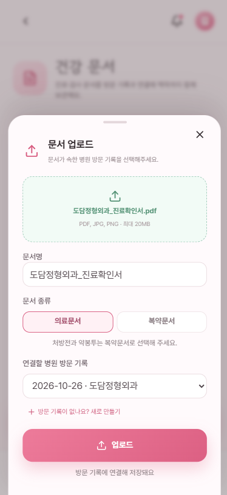

</details>

<details>
<summary><b>🤖 문서 기반 AI 채팅 화면 보기</b></summary>

<br />

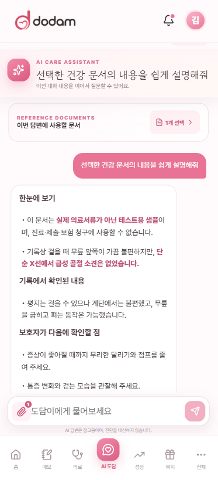

</details>

---

## 8. 🗂️ 프로젝트 구조

<details>
<summary><b>📂 디렉터리 구조 펼쳐보기</b></summary>

```text
Dodam_frontend
├── public
│   ├── dodam-logo.png          # 서비스 로고
│   ├── manifest.webmanifest    # PWA 정보
│   ├── sw.js                   # Cache·Offline·Push Service Worker
│   ├── offline.html            # Offline 대체 화면
│   └── icon-*.png              # PWA 아이콘
├── docs
│   ├── screenshots             # README 화면 이미지
│   ├── care-ui                 # 기록 화면 검증 자료
│   └── PUSH_AND_VISIT_FLOW.md  # Push·방문 기록 검증
├── src
│   ├── main.jsx                # App 진입점과 주요 화면 흐름
│   ├── api.js                  # Spring Backend API Client
│   ├── styles.css              # 공통 UI Style
│   ├── care-workspace.css      # 기록 관리 Layout
│   ├── CalendarScreen.jsx      # 일정·복약·방문 Calendar
│   ├── RecordTimeline.jsx      # 통합 기록 Timeline
│   ├── MemoScreen.jsx          # 육아 메모와 Tag
│   ├── GrowthScreen.jsx        # 성장 기록
│   ├── ChildSheet.jsx          # 아이 선택·등록·관리
│   ├── ProfileEditSheet.jsx    # 보호자 Profile 수정
│   ├── PushSettings.jsx        # Push 설정
│   ├── PushOnboarding.jsx      # 알림 권한 안내
│   ├── push.js                 # Firebase Token 관리
│   ├── vaccination/            # 예방접종 화면
│   ├── welfare/                # 복지 서비스 화면
│   ├── growth.js               # 성장 Chart 계산
│   ├── timeline.js             # Timeline 병합·Page 조회
│   └── *.test.js               # 회귀 테스트
├── index.html
├── vite.config.js
├── package.json
└── README.md
```

</details>

---

## 9. 🚀 로컬 실행

<details open>
<summary><b>▶️ 설치 및 실행</b></summary>

```bash
git clone https://github.com/ieum-connect/Dodam_frontend.git
cd Dodam_frontend
npm ci
npm run dev
```

기본 개발 주소는 `http://localhost:4173`입니다.

Vite는 `/api`, `/oauth2`, `/login/oauth2`, `/logout` 요청을 Local Spring Backend로 Proxy합니다.

</details>

<details>
<summary><b>📦 Production Build와 Preview</b></summary>

```bash
npm run build
npm run preview
```

Build 결과는 `dist/`에 생성됩니다.

</details>

<details>
<summary><b>🔗 함께 실행해야 하는 저장소</b></summary>

- [Dodam Backend](https://github.com/ieum-connect/Dodam_backend)
- [Dodam AI Backend](https://github.com/ieum-connect/Dodam_AI_backend)

AI 서버가 없어도 일정, 메모와 성장 기록 같은 일반 기능은 확인할 수 있습니다. 문서 분석·AI 상담·AI 복지 설명에는 AI Backend가 필요합니다.

</details>

---

## 10. 🔐 환경 변수와 프록시

<details>
<summary><b>⚙️ Frontend 환경 변수 예시</b></summary>

```env
# 개발 Proxy 사용 시 비워 두는 것을 권장합니다.
VITE_API_BASE_URL=

# 고정 AI 테스트 응답임을 화면에 표시합니다.
VITE_AI_TEST_MODE=false
```

</details>

<details>
<summary><b>🛡️ Browser 환경 변수 보안</b></summary>

`VITE_`로 시작하는 값은 Browser Bundle에 포함될 수 있습니다. 다음 정보는 절대 넣지 않습니다.

- AI API Key
- Database 계정
- Firebase 관리자 인증 파일
- JWT Secret
- Spring ↔ AI 내부 통신 Token
- OAuth Client Secret

</details>

<details>
<summary><b>🔀 개발 Proxy 대상 변경</b></summary>

```powershell
$env:DODAM_BACKEND_URL="http://127.0.0.1:8081"
npm run dev
```

</details>

---

## 11. ✅ 테스트와 빌드

<details open>
<summary><b>🧪 검증 명령어</b></summary>

```bash
node --test src/growth.test.js src/timeline.test.js
npm run build
```

```text
Tests: 9 passed
Production build: passed
```

</details>

<details>
<summary><b>📋 회귀 테스트 범위</b></summary>

- 3개월·6개월·12개월 성장 Graph 날짜 범위
- 월말과 윤년 날짜 계산
- 범위 밖이거나 값이 없는 측정 Data 제외
- 최신 성장 기록 정렬
- 병원 방문·문서·메모 날짜 병합
- 취소 일정 제외와 완료 일정 표시
- Cursor 기반 전체 Page 조회
- 반복 Cursor 감지와 요청 취소 처리

</details>

---

<div align="center">

### 아이의 검진 결과를 읽고, 필요한 돌봄으로 💗

Made by **Team IEUM**

</div>
