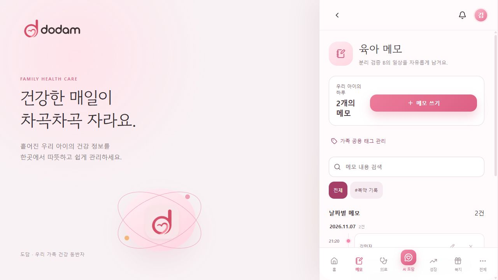
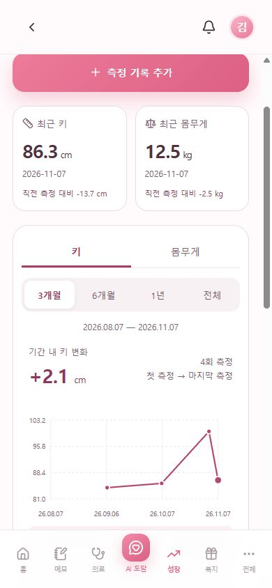

# 11월 7일 보호자 기록 화면 검증

도담의 합성 검증 계정/아이 자료로 확인했다. 실제 의료정보나 실제 AI 응답은 사용하지 않았다.

- 기준: Backend develop `ee16762`, Frontend develop `3b502c4`에 최환우 담당 로컬 변경을 통합.
- 1280px 데스크톱 및 390×844 모바일에서 메모 작성/수정 화면 이동, 태그 표시, 메모→복약 내용 전달, 앱 내 알림 목록과 성장 기간 전환 확인.
- 성장 3개월은 2026-08-07부터, 6개월은 2026-05-07부터, 1년은 2025-11-07부터 표시. 같은 측정 자료도 날짜축상의 위치가 달라진다.
- Backend 통합 테스트 319개, Frontend 날짜 범위/커서 조회 테스트 8개와 production build 통과.
- 운영체제 푸시, 실제 OAuth, 유료 모델 품질, 운영 배포는 이번 검증 범위에 포함하지 않는다.
- Backend 복약/메모 API 및 성장 API PR을 먼저 반영해야 한다.

## 데스크톱 메모

## 모바일 메모

## 모바일 성장 그래프

