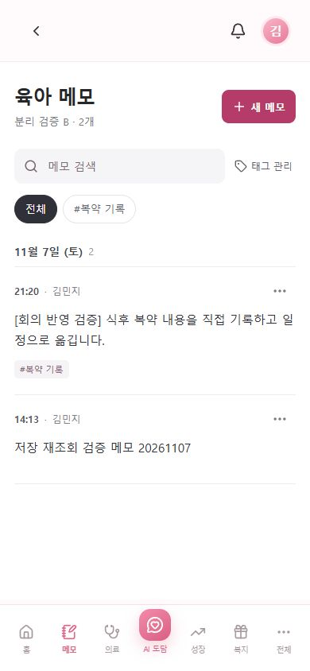
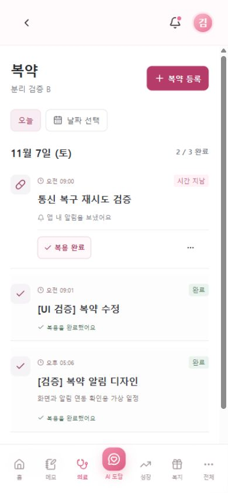
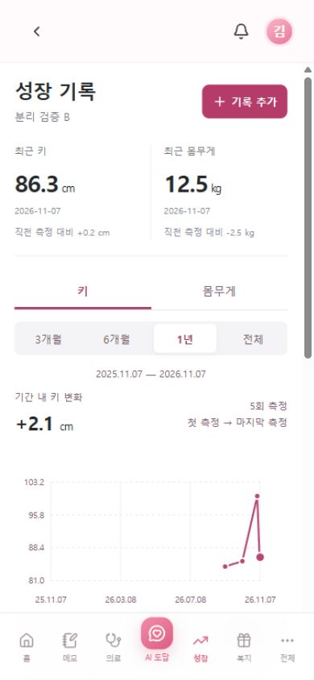
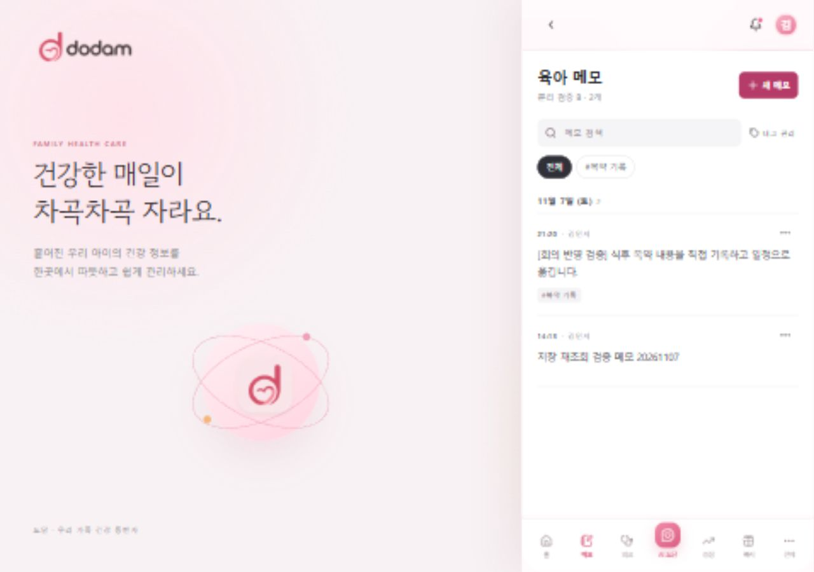

# 담당 화면 UI 재검증 (2026-11-07)

## 범위
- 육아 메모, 복약·일정/캘린더, 성장 기록 화면 내부 배치를 개선했다.
- 홈, 하단 메뉴, 다른 팀원 담당 화면의 디자인은 이번 변경에 포함하지 않는다.
- 목록의 추가 버튼 위치를 통일하고 수정·삭제 등 보조 동작은 더보기 메뉴로 모았다.
- 입력 화면은 목록과 분리하여 저장·취소에 집중할 수 있게 했다.

## 확인 결과
- 로컬 프런트 4186 → Spring 8081 → 도담 전용 PostgreSQL 테스트 DB 연결.
- 테스트 계정 로그인, 메모 수정·저장 후 목록 복귀와 태그 유지 확인.
- 성장 기록 추가(키 86), 수정(86.1), 그래프·목록 반영 확인.
- 성장 3·6·12개월 선택 시 날짜축 변경 확인.
- 복약 직접 생성, 제목·시간 수정, 완료 처리 후 완료 수 1/3 → 2/3 반영 확인.
- 날짜 선택으로 다음 날 목록 전환 확인.
- 알림 처리와 일정 수정이 겹친 버전 충돌: 안내 후 최신 목록 갱신, 재시도 성공 확인. 안내는 변경 주체를 단정하지 않도록 수정했다.
- 모바일 390px 및 데스크톱 1280px에서 메모 배치 확인.
- 성장·타임라인 자동 테스트 8개 통과, 프로덕션 빌드 통과.

## 확인 범위의 한계
- 가상 테스트 데이터만 사용했다. 실제 OAuth, 앱 푸시, 운영 배포 검증은 포함하지 않는다.
- AI 서버 주소를 비워 유료 AI·임베딩 호출을 차단했다. 실제 문서 분석 및 AI 후보 생성은 이번 검증에 포함하지 않는다.
- 반복 일정 API와 알림 로직은 기존 백엔드 PR의 구현이며 이번 디자인 변경에서는 수정하지 않았다.

## 화면

